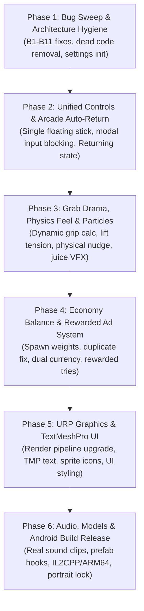

# ClawMachine Master Roadmap: Full Overhaul & Production Polish

> **Context:** Consolidates all 12 sections of [codebase_audit.md](file:///home/drsuavidade/.gemini/antigravity/brain/2073df5c-c85d-46b8-9023-ee08db8bb1f4/codebase_audit.md) into concrete, modular development phases.
> 
> **Key Decisions:**
> 1. Real-arcade auto-return flow (claw ascends -> automatically travels to chute drop point -> drops -> returns to rest).
> 2. Fair non-P2W economy (Rewarded Ads for free plays/refills, optional cosmetics/claw skins, dual-currency coins + gems, no paywalls).
> 3. Grip tension & skill expression: Aim accuracy + weight/shape influence + physical nudge/tumbling on near-misses.
> 4. Modern URP pipeline migration now + TextMeshPro UI overhaul.
> 5. Rich juice, effects, audio, and Android production settings.

---

## Roadmap Overview

---

## Phase Breakdown

### Phase 1: Critical Bug Sweep & Architecture Hygiene (P0)
*Addresses Audit Sections 2, 9, 10*
- **1.1 Duplicate Coins Double Payout (B1):** Refactor `CollectionManager.cs`. Award duplicate coin value once upon collection OR store in inventory to sell manually; stop doing both.
- **1.2 Offline Passive Income Fix (B2):** Only generate offline coins based on actually *owned* machines (`data.ownedMachineIds`), calculating each owned machine's `passiveIncomePerMinute`. Default 0 if no machines owned.
- **1.3 Set Bonus Implementation (B3):** Wire up the advertised +50% speed/grip bonus into `GetTrolleySpeedMultiplier()` and `GetGripPowerMultiplier()` when the active machine is owned/completed.
- **1.4 Camera Shake & Transform Decoupling (B8):** Move camera shake logic out of `ClawAudio.cs` and into `ClawCameraController.cs` as an additive offset calculated before `LateUpdate` lerp.
- **1.5 Double-Fire Event Cleanups (B7):** Remove redundant pointer clickers on `OfflineEarningsModalUI` and `ProgressModalUI`. Deduplicate audio/haptic calls between `MachineController` and `PrizeWinModalUI`.
- **1.6 Reset Progress State Cleanup (B10):** Ensure resetting progress reloads or properly resets scene state, active machine index, and UI displays.
- **1.7 Strip Debug Overlays (B9):** Turn off `showDebugGui` in `ClawGripAnchor.cs` or wrap in `#if UNITY_EDITOR`.
- **1.8 Git Hygiene & Project Identity:** Remove `graphify-out/` tracking, set package identifier `com.yourcompany.clawmachine`, app name, portrait orientation in `ProjectSettings.asset`.

### Phase 2: Unified Input & Real-Arcade Auto-Return (P1)
*Addresses Audit Sections 3, 6, 12 (Q2)*
- **2.1 Unified Bottom Input Model (B4, B5, B6):**
  - Deprecate conflicting full-screen drag and mouse-drag polling in `MachineControlsUI.cs` and `ArcadeJoystickUI.cs`.
  - Implement a clean virtual joystick on the lower console half with continuous velocity updates while held (fixing B5 freeze).
  - Machine switching restricted strictly to carousel header buttons or deliberate top-bar swipe, eliminating accidental mid-aim machine switches (B4).
  - Modal overlay rays: Block all claw and machine input when any modal dialog (Collection, Progress, Settings, Win) is open (B6).
- **2.2 Real-Arcade Auto-Return Sequence:**
  - Activate `ClawState.Returning`: After claw ascends to `homeY` in `Lifting`, immediately transition to `Returning`.
  - Trolley automatically travels directly to `chuteDropPoint` at `config.returnSpeed`.
  - Upon reaching chute coordinates, claw enters `Releasing` and drops the prize into the chute.
  - Claw then returns smoothly to machine home center and enters `Aiming`.

### Phase 3: Grab Drama, Physics Feel & Particles ("Possess Effect") (P2)
*Addresses Audit Sections 3, 5, 7, 12 (Q1, Q5)*
- **3.1 Dynamic Grip & Tension System:**
  - Remove instant binary distance-check win teleport.
  - Calculate `gripQuality = f(aimDistance, prizeWeight, prizeRadius, clawUpgradeLevel)`.
  - Add outcomes:
    - *Clean Grip:* Firmly secured.
    - *Tension Slip:* Lift wobbles, tension creaks; prize slips partway up or during auto-return (pendulum acceleration can dislodge weak grips!).
    - *Near-Miss Nudge:* Claw tips close around prize without latching, physically nudging/tumbling it across the pile.
- **3.2 Physical Nudge & Cascade Wins:**
  - When claw misses or slips, apply physics impulse to nearby toys. Allow knocked-in toys that enter the chute to legitimately count as bonus wins!
- **3.3 Enhanced Particle & "Possess" Visual FX:**
  - Lift tension sparks/cable strain particles on heavy toys.
  - Chute drop confetti, prize sparkle aura on rare/secret toys.
  - Dust puff on claw ground touch and impact burst on prize drop.

### Phase 4: Economy Balance & Rewarded Ad Monetization (P3)
*Addresses Audit Sections 4, 12 (Q3)*
- **4.1 Machine Entry & Progression Balance:**
  - Add fair starter entry cost to Toy Box (e.g. 5 coins) while giving players daily free tickets/coins so it's impossible to get permanently soft-locked.
  - Implement spawn weights in `PrizeSpawner.cs` so Normal = 70%, Rare = 25%, Secret = 5% (making Secret pulls exciting).
  - Machine ownership grants huge perks (passive income, discounts, free daily bonus spins), but not infinite free farming.
- **4.2 Fair Rewarded System (No P2W):**
  - Implement Rewarded Ad hook (mockable service interface `IAdvertisementService`): "Out of coins? Watch an ad to get 5 free claw plays".
  - Add Dual-Currency support: Coins (gameplay loop) + Gems/Tickets (earned via achievements/streaks or optional cosmetic store for claw skins/trails).

### Phase 5: URP Graphics & TextMeshPro UI Modernization (P4)
*Addresses Audit Sections 6, 7, 12 (Q4)*
- **5.1 Universal Render Pipeline (URP) Migration:**
  - Add `com.unity.render-pipelines.universal` to `Packages/manifest.json`.
  - Create URP Asset & Forward Renderer.
  - Convert custom `StylizedToonOutline` shader to URP Shader Graph or URP-compatible HLSL subshader.
  - Upgrade materials and enable mobile bloom / color grading.
- **5.2 TextMeshPro & UI Restyling:**
  - Replace 136 legacy Unity `Text` components with `TextMeshProUGUI`.
  - Replace raw emojis (which render as missing boxes on Android) with TMP sprite asset or custom UI sprite icons.
  - Wire inspector references cleanly, removing string-based `GameObject.Find` and `transform.Find` queries.
  - Consistent rarity palette across all modals (Normal = Cyan, Rare = Purple, Secret = Gold).

### Phase 6: Production Polish, Audio, Models & Android Release (P5, P6)
*Addresses Audit Sections 8, 10, 11*
- **6.1 Audio Overhaul:**
  - Replace procedural sine-wave beeps with real audio clip slots (motor hum, metal claw clank, grab chord, chute drop, win fanfare).
  - Background music track support with volume sliders in Settings.
  - Native short Android haptic vibration via `VibrationEffect` (20ms) instead of 400ms `Handheld.Vibrate()`.
- **6.2 3D Model Replacement Pipeline:**
  - Ready-to-swap prefab hooks in `PrizeDefinition` so importing 3D models from Blender/asset store seamlessly replaces primitives.
- **6.3 Android Build Settings & Verification:**
  - Set Scripting Backend to IL2CPP, Target Architectures to ARM64 + ARMv7.
  - Lock orientation to Portrait. Set `Application.targetFrameRate = 60`.
  - Final end-to-end device testing.
